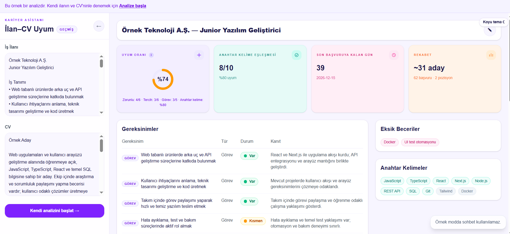
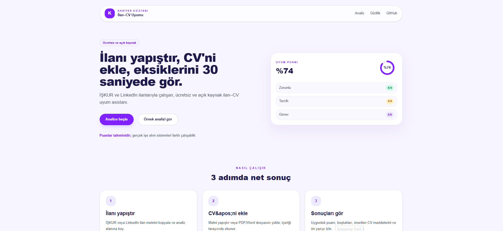
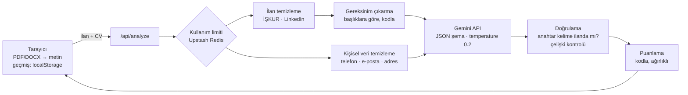

# Kariyer Asistanı — İlan–CV Uyum Analizi

[](https://github.com/asynrphix/kariyer-asistani/actions/workflows/ci.yml)


İŞKUR ve LinkedIn iş ilanlarını CV'nle karşılaştıran, eksiklerini **kanıtıyla** gösteren ücretsiz ve açık kaynak bir web uygulaması.

**🔗 Canlı:** https://kariyer-asistani-seven.vercel.app
**🧪 Örnek analiz (kayıt ve kota gerektirmez):** https://kariyer-asistani-seven.vercel.app/analiz?ornek=1



> English summary [below](#english-summary).

---

## Neden?

İş ararken iki sorunla karşılaştım:

1. **CV'm resim olarak kaydedilmiş bir PDF'ti.** İşe alım sistemleri (ATS) bu dosyadan tek kelime okuyamıyordu — ve bunu kimse bana söylememişti.
2. **Mevcut araçlar** ya ilandan bağımsız genel bir puan veriyor ya da eksik becerilerin listesini ücretli plana saklıyordu.

Kariyer Asistanı ilanın her maddesini tek tek değerlendirir, CV'deki kanıtı gösterir ve bunu ücretsiz yapar.

## Özellikler

- **Madde madde değerlendirme** — Görev, zorunlu ve tercih edilen nitelikleri ayırır; her madde için *Var / Kısmen / Yok* durumunu ve CV'deki kanıtı gösterir. Sadece beceri listesinde geçen becerileri "zayıf kanıt" olarak işaretler.
- **Kodla hesaplanan puan** — Uyum oranını yapay zekâ "tahmin etmez"; maddelerin durumundan ve anahtar kelime eşleşmesinden deterministik olarak hesaplanır. Aynı girdi her zaman aynı puanı verir.
- **İŞKUR ve LinkedIn desteği** — Kopyalanan ilan metnindeki menü, uyarı ve iletişim satırlarını temizler; son başvuru tarihini, başvuru ve pozisyon sayısını çıkarır.
- **PDF / Word yükleme** — Metin tarayıcıda çıkarılır. Resim olarak kaydedilmiş PDF'leri tespit edip uyarır, istenirse görüntüden okur (OCR).
- **Öneriler** — İlanın diline göre yeniden yazılmış CV maddeleri, ön yazı taslağı ve İŞKUR profil önerileri.
- **Kariyer asistanı sohbeti** — Analiz bağlamını bilen, CV'de olmayan deneyimi uydurmayan sohbet.
- **Gizlilik odaklı** — Kayıt yok; geçmiş yalnızca tarayıcıda; CV'deki telefon, e-posta ve adres Gemini'ye gönderilmeden temizlenir.
- **Örnek analiz** — Kota harcamadan, kurgusal bir ilan ve aday üzerinden uygulamanın nasıl çalıştığını gösterir.



## Nasıl çalışır?



Yapay zekâ yalnızca dil anlama gerektiren işi yapar (bir maddenin CV'de karşılanıp karşılanmadığı ve kanıtı). Gereksinim listesinin çıkarılması, anahtar kelimelerin ilanda gerçekten geçtiğinin doğrulanması, çelişkilerin düzeltilmesi ve puanlama kodla yapılır ve testlerle doğrulanır.

### Uyum oranı nasıl hesaplanıyor?

| | Ağırlık / değer |
|---|---|
| Zorunlu nitelik | 2 |
| Tercih sebebi | 1 |
| Görev | 1 |
| Var · Kısmen · Yok | 1 · 0,5 · 0 |
| Sadece beceri listesinde geçen "Var" | 0,75 |

Anahtar kelime puanı, ilandaki teknik terimlerin CV'de bulunma oranıdır (Türkçe karakter normalleştirme ve eş anlamlılar sözlüğüyle). **Uyum oranı**, madde puanı ile anahtar kelime puanının ortalamasıdır.

> Puanlar tahminidir. Gerçek ATS'lerin çoğu tek bir yüzde puanı vermez; CV'yi metne çevirir ve işe alımcı anahtar kelimelerle arar.

### Benzer araçlardan farkı

| | Kariyer Asistanı | Anahtar kelime tabanlı tarayıcılar |
|---|---|---|
| Değerlendirme | Her ilan maddesi ayrı ayrı, kanıtıyla | Kelime eşleşmesi |
| Zorunlu / tercih ayrımı | Var | Genellikle yok |
| "C" ile "C programming" | Aynı beceri | Çoğu zaman ayrı |
| Eksik becerilerin tam listesi | Ücretsiz | Çoğu zaman ücretli planda |
| İŞKUR ilan formatı | Destekleniyor | Desteklenmiyor |

## Teknolojiler

Next.js 16 (App Router) · TypeScript · Tailwind CSS · Google Gemini API (`@google/genai`) · pdfjs-dist · mammoth · Upstash Redis (`@upstash/ratelimit`) · Vitest · GitHub Actions · Vercel (+ çerezsiz Web Analytics)

## Kurulum

Gereksinim: **Node.js 24** (bkz. `.nvmrc`) ve ücretsiz bir [Gemini API anahtarı](https://aistudio.google.com/apikey).

```bash
git clone https://github.com/asynrphix/kariyer-asistani.git
cd kariyer-asistani
npm ci
cp .env.example .env.local   # GEMINI_API_KEY değerini doldur
npm run dev                  # http://localhost:3000
```

| Komut | Açıklama |
|---|---|
| `npm run dev` | Geliştirme sunucusu (yerelde kullanım limiti kapalı) |
| `npm test` | Vitest testleri |
| `npm run lint` | ESLint |
| `npm run build` | Üretim derlemesi |
| `npm run demo:generate` | Örnek analiz verisini (`lib/demo-result.json`) gerçek akışla yeniden üretir |

### Ortam değişkenleri

| Değişken | Zorunlu | Açıklama |
|---|---|---|
| `GEMINI_API_KEY` | Evet | Google AI Studio API anahtarı |
| `GEMINI_MODEL` | Evet | Ana model |
| `GEMINI_FALLBACK_MODEL` | Hayır | Ana model kotası dolarsa veya yoğunsa kullanılır |
| `KV_REST_API_URL`, `KV_REST_API_TOKEN` | Hayır | Upstash Redis; yoksa bellek içi sayaç kullanılır |
| `RATE_LIMIT_SALT` | Hayır | IP özetleri için tuz |
| `GLOBAL_DAILY_LIMIT` | Hayır | Tüm kullanıcılar için günlük toplam istek (varsayılan 400) |
| `NEXT_PUBLIC_SITE_URL` | Hayır | Paylaşım görselleri için sitenin adresi |

## Proje yapısı

```
app/
  page.tsx              Giriş sayfası
  analiz/               Analiz ekranı (+ ?ornek=1 örnek modu)
  gizlilik/             Gizlilik sayfası
  api/analyze|chat|ocr  Sunucu tarafı Gemini çağrıları
components/             Arayüz bileşenleri (analiz paneli, sohbet, footer)
lib/
  iskur.ts linkedin.ts  İlan ayrıştırıcıları
  requirements.ts       Başlıklara göre gereksinim çıkarma
  scoring.ts            Puanlama
  consistency.ts        Çelişki kontrolü
  synonyms.ts           TR/EN eş anlamlılar
  redact.ts             Kişisel veri temizleme
  rate-limit.ts         Kullanım limiti
  gemini.ts             Yeniden deneme, yedek model, hata sınıflandırma
  extract-cv.ts         Tarayıcıda PDF/DOCX okuma
tests/                  Vitest testleri ve anonim fixture'lar
```

## Testler ve CI/CD

`npm test` ile 35 test çalışır: İŞKUR ve LinkedIn ayrıştırma, gereksinim çıkarma, puanlama, eş anlamlılar, çelişki kontrolü, kişisel veri temizleme, kullanım limiti, Gemini hata sınıflandırması ve tarayıcı depolaması.

Her push'ta GitHub Actions `lint → test → build` çalıştırır. `main` dalına yapılan her push Vercel'de otomatik yayınlanır.

## Gizlilik

- Kayıt, çerez ve reklam yok.
- Analiz için ilan ve CV metni Google Gemini API'ye gönderilir; CV'deki telefon, e-posta ve adres önceden temizlenir. Uygulama Gemini'nin ücretsiz katmanını kullanır; bu katmanda Google içeriği ürünlerini geliştirmek için kullanabilir.
- CV ve ilan sunucuda saklanmaz, loglanmaz. Geçmiş yalnızca tarayıcıda tutulur.
- Kullanım limiti için IP adresinin kendisi değil, tuzlanmış özeti en fazla bir gün tutulur.

Ayrıntılar: [Gizlilik sayfası](https://kariyer-asistani-seven.vercel.app/gizlilik)

## Yol haritası

- [ ] LinkedIn ilanlarında firma ve pozisyonun rapor başlığına aktarılması
- [ ] Sohbetteki "sohbette sen belirttin" notunun yalnızca gerektiğinde eklenmesi
- [ ] `/api/analyze` içindeki tekrar eden işlem adımlarının tek fonksiyonda toplanması
- [ ] Embedding tabanlı anlamsal eşleştirme
- [ ] İngilizce arayüz

## English summary

**Kariyer Asistanı** is a free, open-source web app that compares a job posting (Turkish public employment agency İŞKUR or LinkedIn) with a CV. It evaluates every requirement separately (task / mandatory / preferred), shows *Met / Partially / Not met* with evidence from the CV, and computes a deterministic match score in code — the LLM (Google Gemini) is only used for language understanding. It detects image-only PDFs that ATS software cannot read, strips phone/e-mail/address before calling the API, keeps history only in the browser, and enforces per-user and global daily limits with Upstash Redis.

Built with Next.js 16, TypeScript, Tailwind CSS, Gemini API, Vitest, GitHub Actions and Vercel. **Live:** https://kariyer-asistani-seven.vercel.app

## Lisans

[MIT](LICENSE) © 2026 Ayşenur Aslan

## Geliştiren

**Ayşenur Aslan** — Bilgisayar Mühendisi · [GitHub](https://github.com/asynrphix)
